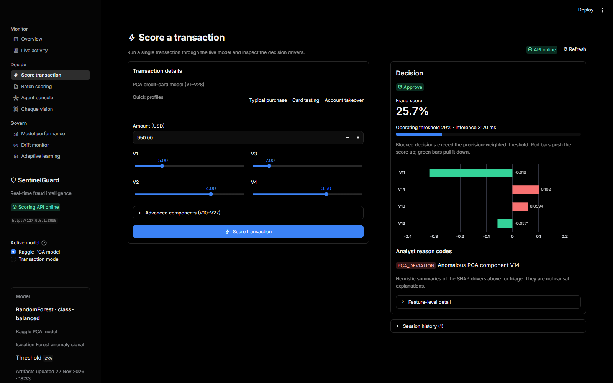
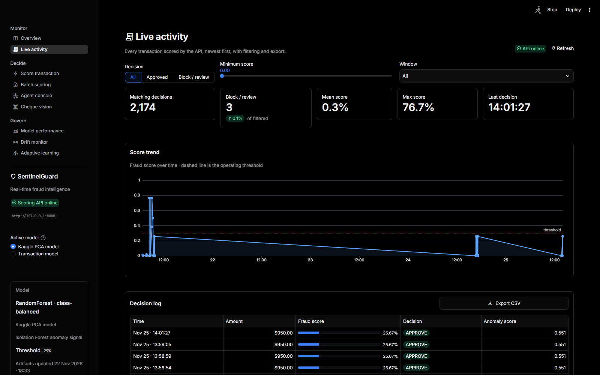
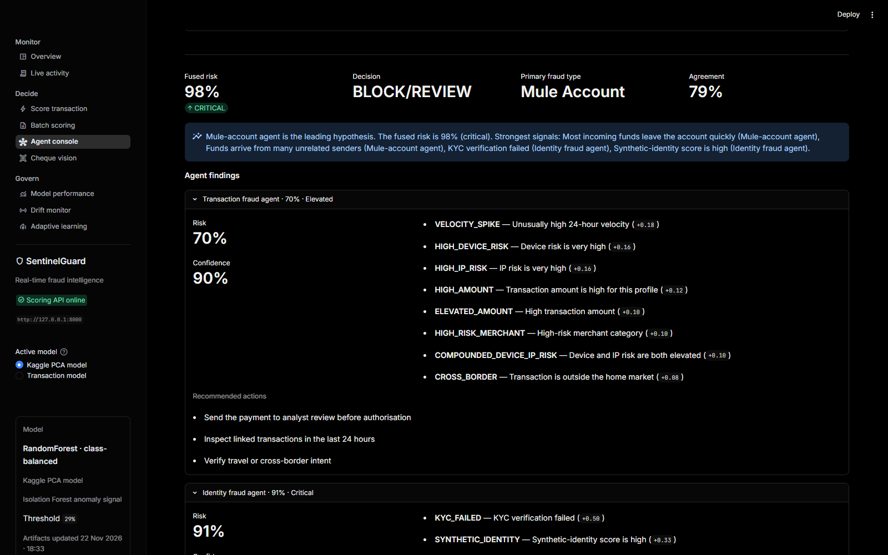
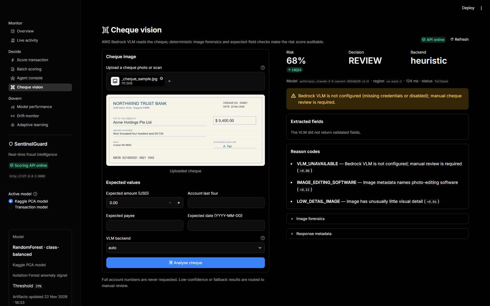
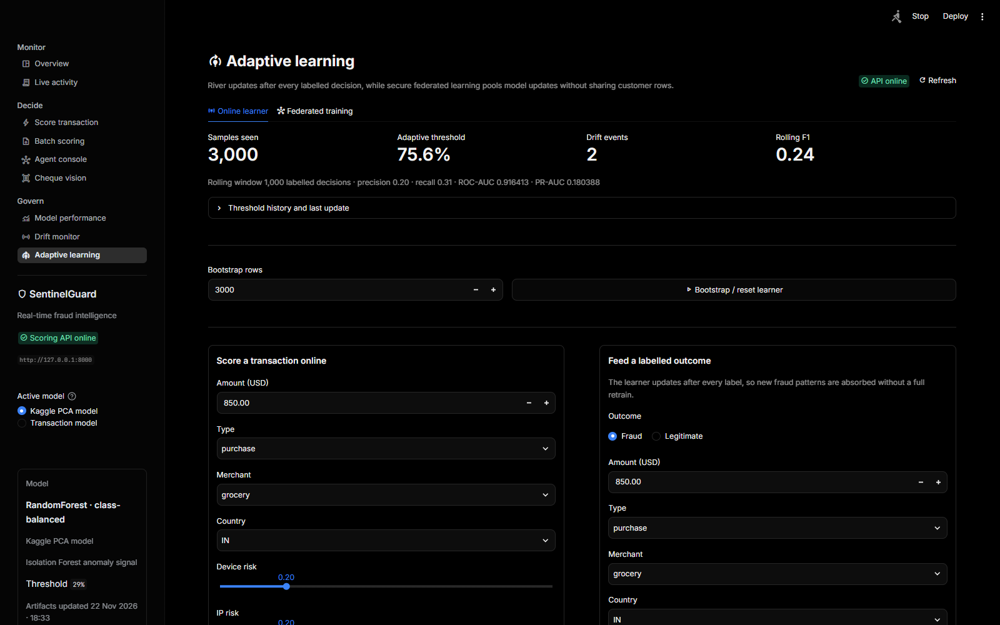
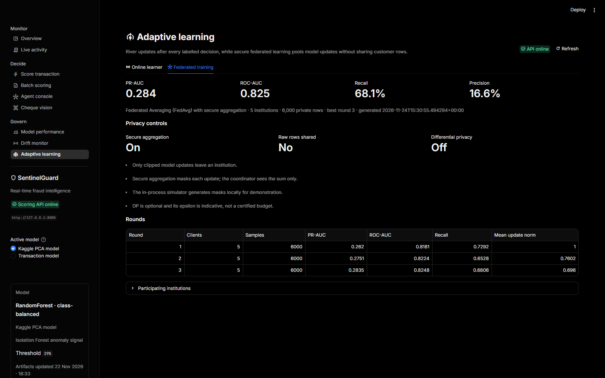

# SentinelGuard - Real-Time Fraud Detection with Explainable Risk Scoring

Advanced-level build: two schema-specific models (Kaggle PCA and transaction features),
each with an Isolation Forest anomaly feature, class-balanced RandomForest, and
precision-weighted threshold, plus SHAP explanations and analyst reason codes per
transaction, cost-sensitive threshold policy simulation, calibration and baseline
diagnostics, FastAPI scoring API, Prometheus/Grafana monitoring, PSI drift detection,
Streamlit analyst dashboard, Docker.

On top of the batch model the stack adds four advanced detection capabilities:

- **Federated learning** — institutions train together with secure aggregation; only
  clipped model updates leave a bank, never customer rows.
- **Cheque vision** — AWS Bedrock VLM reads cheque images, combined with deterministic
  image forensics and expected-field checks.
- **Multi-agent triage** — independent transaction, identity, and mule-account agents
  fuse into one decision with evidence and recommended actions.
- **Online learning** — a River model updates after every labelled decision, adapts its
  threshold, and flags concept drift with ADWIN.


**[▶ Watch the 30-second demo walkthrough](docs/demo.mp4)**

## Run (about 30 minutes)
Requires Python 3.10+ (CI targets 3.11; the local environment runs 3.13).

```powershell
python -m venv venv
.\venv\Scripts\Activate.ps1        # macOS/Linux: source venv/bin/activate
python -m pip install -r requirements.txt
python -m src.make_data --n 300000                    # or put the Kaggle CSV in data/ (see below)
python -m src.train --data data/creditcard.csv       # Kaggle PCA model
python -m src.train --data data/transactions.csv     # transaction model (auto-suffixed)
python -m src.federated --demo --clients 5 --rounds 5   # federated report + model
python -m src.online_learning --data data/transactions.csv `
    --bootstrap-rows 20000 --stream-rows 5000           # online learner
python -m uvicorn api.main:app --port 8000             # terminal 1
python -m streamlit run app/streamlit_app.py          # terminal 2
```

If `streamlit` or `uvicorn` is not recognized, that usually means pip installed
their launchers in a per-user scripts directory that is not on `PATH`. The
`python -m ...` forms above always use the active interpreter, so prefer them.

### Python environment

Use the venv interpreter explicitly if you prefer not to activate it:

```powershell
cd D:\SentinelGuard
.\venv\Scripts\python.exe -m pip install -r requirements.txt
.\venv\Scripts\python.exe -m streamlit run app/streamlit_app.py
```

The system `python` also works when the requirements are installed:

```powershell
python -m streamlit run app/streamlit_app.py
```

If `venv\Scripts\python.exe` points to a missing interpreter or the wrong Python
version, rebuild the environment:

```powershell
cd D:\SentinelGuard
Remove-Item -Recurse -Force venv
python -m venv venv
.\venv\Scripts\python.exe -m pip install --upgrade pip
.\venv\Scripts\python.exe -m pip install -r requirements.txt
```

Verify it before running the dashboard:

```powershell
.\venv\Scripts\python.exe --version
.\venv\Scripts\python.exe -m streamlit --version
```

AWS Bedrock is optional. Without credentials the cheque endpoint returns a
deterministic forensic review instead of a VLM assessment, so the rest of the
stack works offline. Configure it with:

```bash
export AWS_REGION=us-east-1
export BEDROCK_VLM_MODEL_ID=anthropic.claude-3-5-sonnet-20240620-v1:0
export CHEQUE_VLM_BACKEND=auto          # auto | bedrock | heuristic
```
Test the API: http://localhost:8000/docs -> POST /predict

Full stack: `docker compose up --build` (API 8000, dashboard 8501, Prometheus 9090, Grafana 3000).

## Docker and Grafana

```bash
cp .env.example .env        # set GRAFANA_ADMIN_PASSWORD
docker compose up --build
```

| Service | URL | Notes |
| --- | --- | --- |
| API | http://localhost:8000/docs | Scoring, batch and policy endpoints |
| Dashboard | http://localhost:8501 | Analyst console |
| Prometheus | http://localhost:9090 | Scrapes the API every 5 s |
| Grafana | http://localhost:3000 | Dashboard **SentinelGuard · Fraud API**; `admin` / password from `.env` |

Grafana needs no manual setup: `grafana/provisioning/` registers the Prometheus
datasource, and `grafana/dashboards/sentinelguard.json` is loaded on startup with
panels for decision throughput, decision mix, block rate, alerts per minute,
inference latency p50/p95/p99, mean latency and scrape health. The containers run
as a non-root user with healthchecks and `restart: unless-stopped`. Models and
`data/` are baked into the image, so train before building (or mount them).

## Deploy on EC2

1. Launch an Ubuntu 24.04 instance (`t3.medium` or larger — the image build needs
   RAM) with a 16 GB root volume. Security group: allow 22 from your IP, plus 80
   (nginx) and optionally 3000/8000/8501/9090 while evaluating.
2. Get the project onto the instance:
   ```bash
   git clone https://github.com/<you>/sentinelguard.git /opt/sentinelguard
   ```
3. Bootstrap Docker, the systemd service and the nginx proxy:
   ```bash
   cd /opt/sentinelguard
   sudo bash deploy/ec2-bootstrap.sh      # set REPO_URL=... to clone automatically
   ```
4. Set `GRAFANA_ADMIN_PASSWORD` in `/opt/sentinelguard/.env`, then:
   ```bash
   sudo systemctl start sentinelguard
   ```

Result: dashboard at `http://<public-ip>/`, API docs at `http://<public-ip>/api/docs`,
Grafana at `http://<public-ip>:3000`. The bootstrap registers
`sentinelguard.service` (starts on boot, `docker compose up -d`), installs
`deploy/nginx.conf` with websocket upgrades for Streamlit, and the production
overlay `docker-compose.prod.yml` sets `API_ROOT_PATH=/api` so Swagger works behind
the proxy. Add HTTPS with `sudo certbot --nginx -d your.domain`.

Do not expose Grafana or Prometheus publicly without authentication; the default
Grafana password in `.env.example` is a placeholder. The prediction log lives
inside the API container, so add a volume if it must survive container replacement.

## Dashboard
`python -m streamlit run app/streamlit_app.py` opens the analyst console:

| Page | What it shows |
| --- | --- |
| Overview | Decision KPIs, risk-band mix, recent decisions, service health |
| Live activity | Filterable decision log with score trend and CSV export |
| Score transaction | Score one transaction with SHAP reasons and session history |
| Batch scoring | Upload a CSV, validate and score up to 5,000 rows, export results |
| Model performance | Held-out ROC/PR curves, calibration, baselines, threshold policies, confusion matrix, business impact |
| Drift monitor | PSI by feature against the training reference, retrain alerts |
| Agent console | Run transaction, identity, and mule agents; fused risk, evidence, typologies, actions |
| Cheque vision | Upload a cheque; Bedrock VLM fields, forensic flags, expected-value mismatches |
| Adaptive learning | River status, adaptive threshold, ADWIN drift, labelled updates, federated report |

The dashboard reads `models/` and `data/` and calls the API at `http://127.0.0.1:8000`
(override with the `API_URL` environment variable). With the API offline it still
renders model analytics; scoring and live drift need the API running. To populate the
decision log and exercise drift, open **Drift monitor** and choose **Generate 60 demo
transactions**.

**Batch scoring** accepts the Kaggle PCA schema (`Amount` + `V1`–`V28`, optional `Class`)
or the transaction schema (optional `is_fraud`). Both templates are downloadable from
the page. Uploads are validated, capped at 5,000 rows, scored by `POST /predict/batch`,
and routed to the model that matches their schema. They are kept out of the live
decision log so historical files do not distort drift monitoring. Use the sidebar's
**Active model** switch to inspect each model's metrics and reference distribution.

## Datasets
- **Kaggle Credit Card** — drop `creditcard.csv` in `data/`; `build_features` uses
  `V1`–`V28` plus `log_amount`.
- **Transaction schema** — `timestamp, amount, tx_type, merchant_category, country,
  device_risk, ip_risk, account_age_days, tx_count_24h, is_fraud`. `src/make_data.py`
  generates a demo file.

Training on `data/transactions.csv` writes `models/*_synthetic.*` automatically, so it
never overwrites the Kaggle artifacts. The API and dashboard serve both bundles and
route by schema.

## Decision layer

### Threshold policy simulation
`src/policy.py` scores every candidate cutoff on the held-out split and writes
`models/threshold_policy*.json/.csv/.md` with five explicit policies:

| Policy | Rule |
| --- | --- |
| `cost_optimized` | Minimises review cost + missed-fraud cost |
| `balanced_f1` | Maximises F1 |
| `high_recall` | Smallest cutoff reaching 95% recall |
| `high_precision` | Highest recall while precision stays at 90% |
| `review_capacity` | Highest recall within a 2% review budget |

Costs default to $1.25 per review and $15 per missed fraud, and missed fraud value
(loss + chargebacks) is included. These artifacts are decision support for analyst
review, not approved rules. `python -m src.train ...` generates them automatically;
to refresh them for an already trained bundle:

```bash
python -m src.policy --data data/creditcard.csv
python -m src.policy --data data/transactions.csv --bundle models/bundle_synthetic.joblib --suffix _synthetic
```

### Reason codes
The scoring API turns its top SHAP drivers into stable analyst codes
(`HIGH_DEVICE_RISK`, `ANOMALY_SIGNAL`, `VELOCITY_SPIKE`, …) that the dashboard shows
under the SHAP chart. Reason codes are heuristic triage summaries, not causal
explanations.

### Calibration and baselines
Training also stores the Brier score, a reliability curve and trivial baselines
(never alert, alert everything, random) in `metrics*.json`, shown on **Model
performance** so predicted probabilities are judged, not just ranking.

## Advanced detection

### Federated learning (`src/federated.py`)
Institutions train a shared logistic model without pooling customer data. Each
client performs local epochs, clips its update, and sends only the update vector.
The coordinator uses FedAvg; with secure aggregation enabled, pairwise one-time-pad
masks over a 61-bit prime cancel in the sum, so individual institution updates are
never visible to it. Optional client-level Gaussian DP adds calibrated noise.

```bash
python -m src.federated --demo --clients 5 --rounds 5
python -m src.federated --data data/transactions.csv --clients 5 --rounds 8 --dp
```

Artifacts: `models/federated_report.json`, `models/federated_report.md`, and
`models/federated_model.joblib`. The report records per-round metrics, the
aggregation scheme, client sample counts, and the privacy contract
(`raw_rows_shared: false`, `individual_updates_visible: false`).

Privacy caveats: the in-process simulator generates masks locally for demonstration;
a production deployment derives them from Diffie-Hellman shared secrets. DP is
optional and the reported epsilon is an indicative classical estimate, not a
certified budget. Secure aggregation hides individual updates but does not by itself
defend against poisoning or inference from the final model.

### Cheque vision (`src/cheque_vlm.py`)
The API sends the cheque image and a forensic checklist to an AWS Bedrock
vision-language model using the `converse` API. The response must be a JSON object;
it is validated with Pydantic, compared with expected amount/payee/account/date, and
combined with deterministic image checks (EXIF editing software, resolution, aspect
ratio, entropy, near-blank detection). Invalid or unavailable model responses fall
back to an explicit **manual review** decision rather than a clean approval.

```bash
python -m src.cheque_vlm --image cheque.png --expected-amount 2400 \
    --expected-payee "Acme Ltd" --account-last4 4821
```

Only the image SHA-256 digest, backend, decision, reason codes, and warnings are
written to `models/cheque_audit.jsonl`; raw image bytes are never persisted by this
module, and the prompt asks for the last four account digits only.

### Multi-agent triage (`src/agents/`)
Three deterministic specialists evaluate one case:

| Agent | Mandate |
| --- | --- |
| `transaction_agent` | Model score, SHAP reason codes, amount/velocity/geography rules |
| `identity_agent` | KYC, synthetic identity, document tamper, device/email/phone reuse, sanctions/PEP |
| `mule_agent` | Fan-in/fan-out, pass-through, dormancy, round amounts, structuring, beneficiary risk |

The orchestrator fuses findings with explicit weights, keeps a single strong finding
from being diluted, adds a corroboration bonus when independent agents agree, and
returns the primary fraud type, typologies, narrative, and recommended actions. An
agent exception is isolated and surfaced in that agent's finding instead of failing
the whole decision. Agents are rules plus optional model evidence, not an autonomous
LLM swarm, so every decision is reproducible and inspectable.

### Online learning (`src/online_learning.py`)
A River pipeline (`StandardScaler` + `LogisticRegression`) updates after every
labelled decision. It uses class-weighted fraud updates, retunes a bounded adaptive
threshold from a rolling labelled window, and watches the error stream with ADWIN.
State is pickled atomically to `models/online_model.pkl`; events are appended to
`models/online_events.jsonl`.

```bash
python -m src.online_learning --data data/transactions.csv \
    --bootstrap-rows 20000 --stream-rows 5000
```

The online score is fused into the transaction agent only after the learner is warm
(50 samples), so an untrained model cannot distort triage.

### API endpoints
| Endpoint | Purpose |
| --- | --- |
| `POST /predict` | Score one transaction; returns SHAP reasons + reason codes |
| `POST /predict/batch` | Score up to 5,000 transactions |
| `POST /agents/analyze` | Transaction + identity + mule agents and fused decision |
| `GET /agents/catalog` | Agent mandates and fusion weights |
| `POST /cheque/analyze` | Multipart cheque image; Bedrock VLM + forensics |
| `GET /online/status` | River state, rolling metrics, threshold, ADWIN drift |
| `POST /online/predict` | Online fraud score for one transaction |
| `POST /online/learn` | Label one transaction and update the online model |
| `POST /online/bootstrap` | Warm-start/reset the learner from local or synthetic data |
| `GET /federated/status` | Latest secure-aggregation training report |
| `GET /policy?mode=synthetic` | Generated threshold policy artifacts |
| `GET /drift` | PSI report over recent logged predictions |
| `GET /health`, `GET /metrics` | Liveness, capabilities, and Prometheus metrics |


## Screenshots and demo video

| | |
| --- | --- |
|  |  |
|  |  |
|  |  |
|  |  |
|  |  |


**[▶ Download the 30-second walkthrough (MP4, 3.3 MB)](docs/demo.mp4)**

Screenshots and the video are generated, not hand-taken. After a UI change run
(needs Chrome and ffmpeg on PATH, override with `CHROME_PATH` / `FFMPEG`):

```bash
python scripts/capture_media.py
```

The script starts a fresh API and dashboard (fails if ports 8000/8501 are busy;
pass `--reuse-existing` to capture against a running stack), scores 160 demo
transactions, bootstraps the River learner, uploads a generated cheque, exercises
the agent, score, batch and drift controls, captures every dashboard page, writes
`docs/screenshots/*.png`, and rebuilds the `docs/demo.mp4` walkthrough.

## Tests

```bash
python -m unittest discover -s tests -v
```

`tests/` covers the policy engine, reason-code mapping, federated aggregation and
privacy contract, the agent orchestrator, Bedrock response parsing and image
forensics, and River online learning. The GitHub Actions workflow in
`.github/workflows/ci.yml` compiles the sources and runs the suite.

