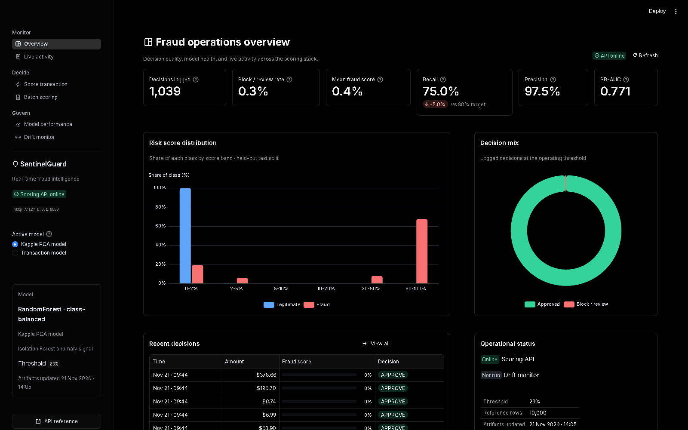
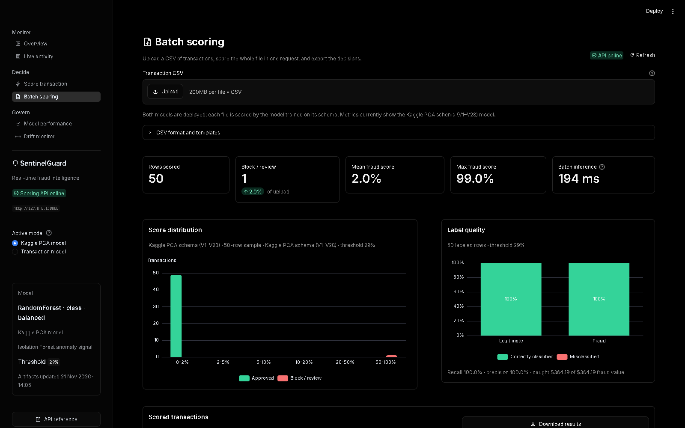
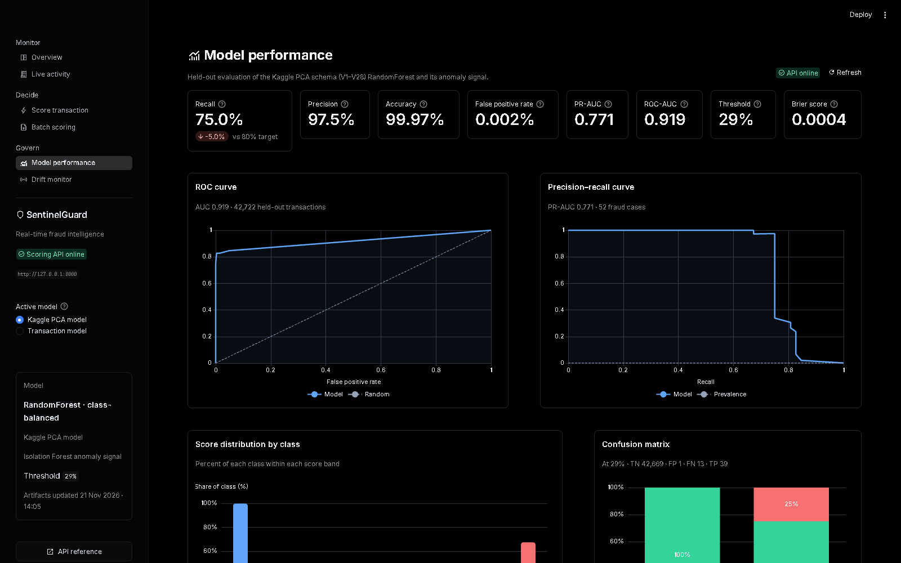
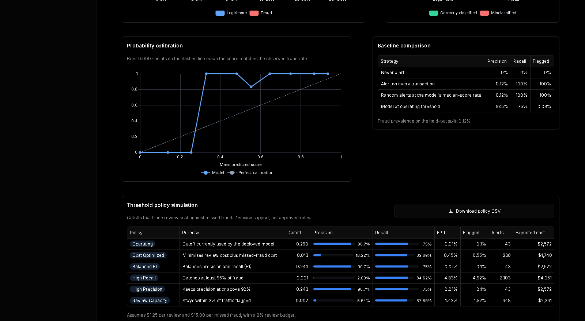
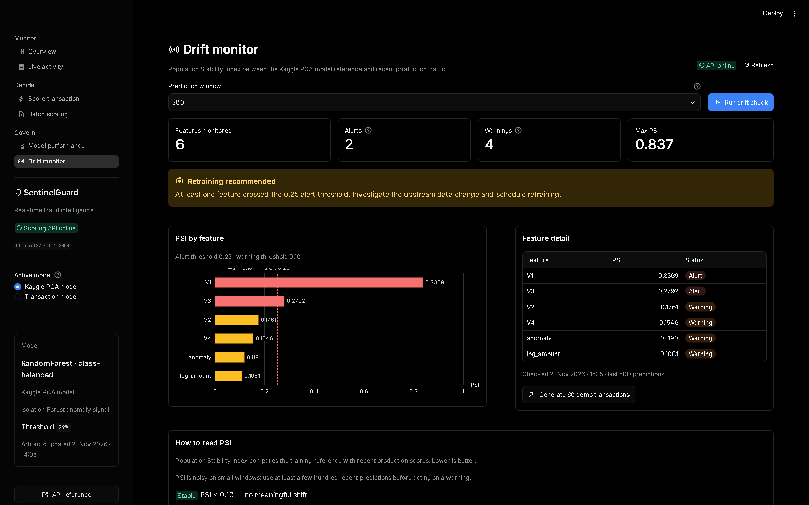

# SentinelGuard - Real-Time Fraud Detection with Explainable Risk Scoring

Advanced-level build: two schema-specific models (Kaggle PCA and transaction features),
each with an Isolation Forest anomaly feature, class-balanced RandomForest, and
precision-weighted threshold, plus SHAP explanations and analyst reason codes per
transaction, cost-sensitive threshold policy simulation, calibration and baseline
diagnostics, FastAPI scoring API, Prometheus/Grafana monitoring, PSI drift detection,
Streamlit analyst dashboard, Docker.


**[▶ Watch the 20-second demo walkthrough](docs/demo.mp4)** ·

## Run (about 30 minutes)
```bash
python -m venv venv && venv\Scripts\activate      # Mac: source venv/bin/activate
pip install -r sentinelguard\requirements.txt
python -m src.make_data --n 300000                    # or put the Kaggle CSV in data/ (see below)
python -m src.train --data data/creditcard.csv       # Kaggle PCA model
python -m src.train --data data/transactions.csv     # transaction model (auto-suffixed)
uvicorn api.main:app --port 8000                      # terminal 1
streamlit run app/streamlit_app.py                    # terminal 2
```
Test the API: http://localhost:8000/docs -> POST /predict

Full stack: `docker compose up --build` (API 8000, dashboard 8501, Prometheus 9090, Grafana 3000).

## Docker and Grafana

```bash
cp .env.example .env        # set GRAFANA_ADMIN_PASSWORD
docker compose up --build
```

| Service | URL | Notes |
| --- | --- | --- |
| API | http://localhost:8000/docs | Scoring, batch and policy endpoints |
| Dashboard | http://localhost:8501 | Analyst console |
| Prometheus | http://localhost:9090 | Scrapes the API every 5 s |
| Grafana | http://localhost:3000 | Dashboard **SentinelGuard · Fraud API**; `admin` / password from `.env` |

Grafana needs no manual setup: `grafana/provisioning/` registers the Prometheus
datasource, and `grafana/dashboards/sentinelguard.json` is loaded on startup with
panels for decision throughput, decision mix, block rate, alerts per minute,
inference latency p50/p95/p99, mean latency and scrape health. The containers run
as a non-root user with healthchecks and `restart: unless-stopped`. Models and
`data/` are baked into the image, so train before building (or mount them).

## Deploy on EC2

1. Launch an Ubuntu 24.04 instance (`t3.medium` or larger — the image build needs
   RAM) with a 16 GB root volume. Security group: allow 22 from your IP, plus 80
   (nginx) and optionally 3000/8000/8501/9090 while evaluating.
2. Get the project onto the instance:
   ```bash
   git clone https://github.com/<you>/sentinelguard.git /opt/sentinelguard
   ```
3. Bootstrap Docker, the systemd service and the nginx proxy:
   ```bash
   cd /opt/sentinelguard
   sudo bash deploy/ec2-bootstrap.sh      # set REPO_URL=... to clone automatically
   ```
4. Set `GRAFANA_ADMIN_PASSWORD` in `/opt/sentinelguard/.env`, then:
   ```bash
   sudo systemctl start sentinelguard
   ```

Result: dashboard at `http://<public-ip>/`, API docs at `http://<public-ip>/api/docs`,
Grafana at `http://<public-ip>:3000`. The bootstrap registers
`sentinelguard.service` (starts on boot, `docker compose up -d`), installs
`deploy/nginx.conf` with websocket upgrades for Streamlit, and the production
overlay `docker-compose.prod.yml` sets `API_ROOT_PATH=/api` so Swagger works behind
the proxy. Add HTTPS with `sudo certbot --nginx -d your.domain`.

Do not expose Grafana or Prometheus publicly without authentication; the default
Grafana password in `.env.example` is a placeholder. The prediction log lives
inside the API container, so add a volume if it must survive container replacement.

## Dashboard
`streamlit run app/streamlit_app.py` opens the analyst console:

| Page | What it shows |
| --- | --- |
| Overview | Decision KPIs, risk-band mix, recent decisions, service health |
| Live activity | Filterable decision log with score trend and CSV export |
| Score transaction | Score one transaction with SHAP reasons and session history |
| Batch scoring | Upload a CSV, validate and score up to 5,000 rows, export results |
| Model performance | Held-out ROC/PR curves, calibration, baselines, threshold policies, confusion matrix, business impact |
| Drift monitor | PSI by feature against the training reference, retrain alerts |

The dashboard reads `models/` and `data/` and calls the API at `http://127.0.0.1:8000`
(override with the `API_URL` environment variable). With the API offline it still
renders model analytics; scoring and live drift need the API running. To populate the
decision log and exercise drift, open **Drift monitor** and choose **Generate 60 demo
transactions**.

**Batch scoring** accepts the Kaggle PCA schema (`Amount` + `V1`–`V28`, optional `Class`)
or the transaction schema (optional `is_fraud`). Both templates are downloadable from
the page. Uploads are validated, capped at 5,000 rows, scored by `POST /predict/batch`,
and routed to the model that matches their schema. They are kept out of the live
decision log so historical files do not distort drift monitoring. Use the sidebar's
**Active model** switch to inspect each model's metrics and reference distribution.

## Datasets
- **Kaggle Credit Card** — drop `creditcard.csv` in `data/`; `build_features` uses
  `V1`–`V28` plus `log_amount`.
- **Transaction schema** — `timestamp, amount, tx_type, merchant_category, country,
  device_risk, ip_risk, account_age_days, tx_count_24h, is_fraud`. `src/make_data.py`
  generates a demo file.

Training on `data/transactions.csv` writes `models/*_synthetic.*` automatically, so it
never overwrites the Kaggle artifacts. The API and dashboard serve both bundles and
route by schema.

## Decision layer

### Threshold policy simulation
`src/policy.py` scores every candidate cutoff on the held-out split and writes
`models/threshold_policy*.json/.csv/.md` with five explicit policies:

| Policy | Rule |
| --- | --- |
| `cost_optimized` | Minimises review cost + missed-fraud cost |
| `balanced_f1` | Maximises F1 |
| `high_recall` | Smallest cutoff reaching 95% recall |
| `high_precision` | Highest recall while precision stays at 90% |
| `review_capacity` | Highest recall within a 2% review budget |

Costs default to $1.25 per review and $15 per missed fraud, and missed fraud value
(loss + chargebacks) is included. These artifacts are decision support for analyst
review, not approved rules. `python -m src.train ...` generates them automatically;
to refresh them for an already trained bundle:

```bash
python -m src.policy --data data/creditcard.csv
python -m src.policy --data data/transactions.csv --bundle models/bundle_synthetic.joblib --suffix _synthetic
```

### Reason codes
The scoring API turns its top SHAP drivers into stable analyst codes
(`HIGH_DEVICE_RISK`, `ANOMALY_SIGNAL`, `VELOCITY_SPIKE`, …) that the dashboard shows
under the SHAP chart. Reason codes are heuristic triage summaries, not causal
explanations.

### Calibration and baselines
Training also stores the Brier score, a reliability curve and trivial baselines
(never alert, alert everything, random) in `metrics*.json`, shown on **Model
performance** so predicted probabilities are judged, not just ranking.

### API endpoints
| Endpoint | Purpose |
| --- | --- |
| `POST /predict` | Score one transaction; returns SHAP reasons + reason codes |
| `POST /predict/batch` | Score up to 5,000 transactions |
| `GET /policy?mode=synthetic` | Generated threshold policy artifacts |
| `GET /drift` | PSI report over recent logged predictions |
| `GET /health`, `GET /metrics` | Liveness and Prometheus metrics |

## Screenshots and demo video

| | |
| --- | --- |
|  |  |
|  |  |
|  |  |



**[▶ Download the 20-second walkthrough (MP4, 1.7 MB)](docs/demo.mp4)**

Screenshots and the video are generated, not hand-taken. After a UI change run
(needs Chrome and ffmpeg on PATH, override with `CHROME_PATH` / `FFMPEG`):

```bash
python scripts/capture_media.py
```

The script reuses or starts the API and dashboard, scores 160 demo transactions so
the feed and drift window are populated, clicks the score preset, batch sample and
drift check, writes `docs/screenshots/*.png`, and rebuilds `docs/demo.mp4`.

## Tests

```bash
python -m unittest discover -s tests -v
```

`tests/` covers the policy engine and reason-code mapping; the GitHub Actions
workflow in `.github/workflows/ci.yml` compiles the sources and runs the suite.

